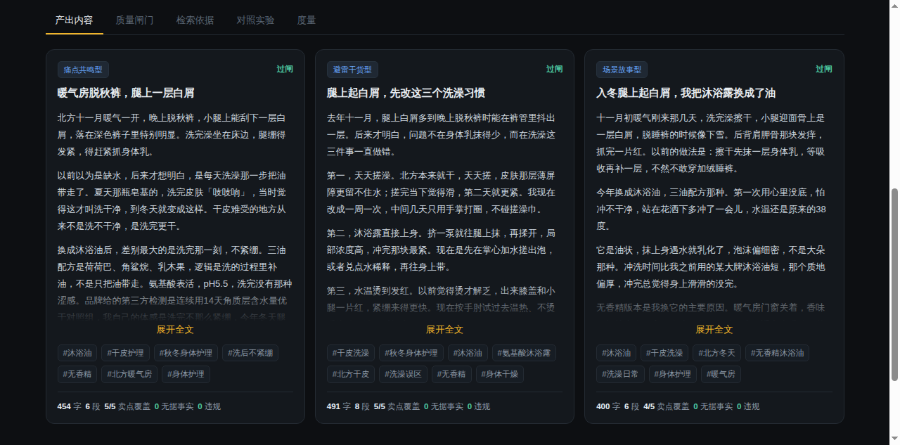
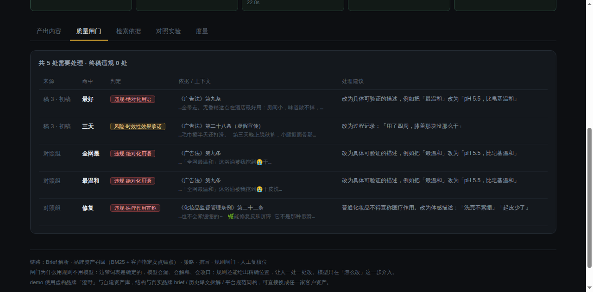

# 种草流水线 · Brand Content Copilot

一条 brief → 3 篇可交付的小红书种草稿，每篇可溯源、过合规闸门、带指标。

**这是一个能跑的 demo，不是方案文档。** 本地 30 秒起：

```bash
cd grass-copilot
python3 server.py
# → http://localhost:8017
```

零第三方依赖，只需要一个 LLM API key（配在 `~/.hermes/.env` 的 `DEEPSEEK_API_KEY`）。




---

## 它解决什么

内容营销公司现在的情况是：**个人提效已经发生，组织提效没发生**。

- 策划自己用 AI 写得飞快，换个人接手同一客户，品牌调性、卖点边界、哪句话不能说，还得从头讲一遍；
- 已有的 AI 内容系统大多停在"关键词 → 出稿"，产出无法向客户解释、无法追责；
- 真实成本不在写，在改和担责：一句"修复屏障""7天见效""全网最"就够删稿限流；
- 平台已经能识别模板化批量内容，**"生成更快"在种草地盘上是负资产**。

所以这个系统做的不是"更快的写手"，是**产线**：把资深策划的判断变成可复用、可追溯、可度量的流程。

---

## 六段链路

| 步骤 | 做什么 | 为什么单独一步 |
|---|---|---|
| ① Brief 解析 | 自然语言 brief → 目标 / 人群 / 痛点 / 必说卖点 / 禁区 | 客户原话里的执行要求，和可用的事实主张不是一回事 |
| ② 资产召回 | BM25 检索品牌资产 + **客户指定卖点锚点** | 客户点名的卖点不能交给相似度碰运气 |
| ③ 内容策略 | 出 3 条不同骨架（痛点共鸣 / 避雷干货 / 场景故事） | 一次出 3 篇同结构的稿子是负资产 |
| ④ 撰写 | 并行生成，只允许引用有证据的资产 | 编造数字比违禁词更贵 |
| ⑤ 合规闸门 | 规则引擎拦违规词 + 数字白名单核事实 | 违禁词表是确定的，不能交给模型自查 |
| ⑥ 度量 | 一次通过率 / 改写率 / 覆盖率 / 耗时 | 没有度量就没有迭代 |

---

## 三个可验证的结论

1. **闸门用规则、模型只做改写。** 模型做合规会漏会改口；规则能给出精确位置，让人一处一处改。
2. **每次运行都跑对照组**（裸生成，无资产无调性无闸门），同一套指标打分。诚实地说：正常 brief 下裸生成也不差（4/5 覆盖、0 违规）；差距在"客户硬塞不合规说法"时拉开——裸生成原样写进去，闸门拦下 5 处、改写后为 0。
3. **不追求一次写对。** 链路是「生成 → 拦截 → 改写 → 复核」，改写只动有问题的句子，允许承认局限（"用久了还是会干"），这比硬转话术更可信。

实测（本机 deepseek-flash）：3 篇 + 1 篇对照，端到端 **≈49 秒 / 8 次模型调用**。

---

## 目录

```
grass-copilot/
├── server.py              # stdlib HTTP + SSE，零依赖
├── engine/
│   ├── retriever.py       # 中文 char-bigram BM25 + 锚点召回
│   ├── audit.py           # 合规规则引擎（含误报排除）
│   ├── factcheck.py       # 数字类主张的事实核对
│   ├── pipeline.py        # 六段链路 + 对照组
│   └── llm.py             # LLM 客户端（含截断重试）
├── data/brand_assets.json # 品牌资产库 + 合规规则（虚构品牌「澄野」）
├── web/index.html         # 单文件前端，无构建
└── docs/项目说明.md        # 设计判断、指标定义、边界与路线
└── docs/演示脚本.md        # 3 分钟怎么讲
```

demo 使用虚构品牌「澄野」与自建资产库，结构与真实客户的品牌 brief / 历史爆文拆解 / 平台规范同构，可直接替换。
